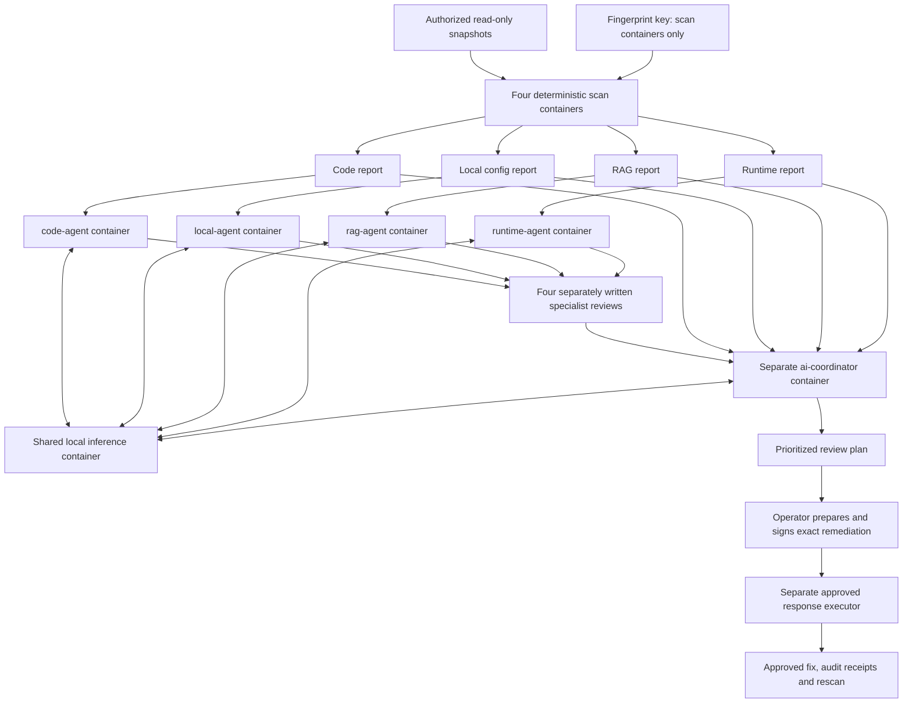

# SEERE architecture: independent AI specialist containers

## Implemented topology



There are four deterministic scanners and four AI specialist processes, followed by a distinct AI coordinator. One model server is shared infrastructure. Agent separation does not require loading identical weights into each agent container. Model-server scheduling controls concurrent inference; agent resource limits do not reserve GPU or inference capacity individually.

## Container boundaries

| Service | Readable inputs | Writable output | Inference role |
|---|---|---|---|
| code-agent | Code report + manifest | reviews/code/review.json | Code/Git specialist |
| local-agent | Local-config report + manifest | reviews/local/review.json | Local credential/config specialist |
| rag-agent | RAG report + manifest | reviews/rag/review.json | RAG specialist |
| runtime-agent | Runtime report + manifest | reviews/runtime/review.json | Runtime specialist |
| ai-coordinator | All reports, all reviews + manifest | plan/ai-plan.json | Aggregate interpretation only |
| local-model | Preloaded model weights | Temporary runtime storage | Shared inference service |

AI agents receive no raw source snapshot, fingerprint key, approval key or source-write mount. They run non-root by default, with a read-only root filesystem, dropped capabilities, no privilege escalation and bounded CPU/memory/process settings. Every specialist has its own report input mount and review output mount.

Agents communicate with `http://local-model:11434` over a Docker internal bridge network. No ports are published. Unlike the original loopback-only design, separate network namespaces require a trusted service hostname. The model adapter allows `local-model` only when explicitly enabled by `--allow-container-model`; default callers remain loopback-only. Redirects and environment proxies remain disabled. The internal network is a shared trust zone, not per-agent network microsegmentation or mutually authenticated inference. Deploy stronger network policy/TLS if the threat model requires it.

## Run and review contracts

1. Operator initializes a fresh run directory and manifest.
2. Deterministic scanners produce four redacted module reports with the same run and fingerprint-key IDs.
3. Each specialist validates its module/run and creates numeric features for the model. Paths, notes, source text and raw credentials are excluded from model prompts.
4. Each specialist writes its review atomically. The review contains schema version, role, run ID, key ID, SHA-256 digest of the exact canonical scan report, explicit inference mode and validated risk/reason/action enums.
5. Coordinator validates reviews against their scan reports. Duplicate, unexpected, stale and digest-mismatched reviews fail. Missing reviews or incomplete scans prevent a complete-plan result.
6. Coordinator correlates findings deterministically, reads specialist interpretations and requests only its own aggregate model interpretation. It never reruns specialist inference.
7. Model output remains advisory. Only the separate human approval workflow grants execution authority.

Report digests bind reviews to inputs; they are not cryptographic authentication of the specialist's identity. Host permissions and container mount isolation enforce who can write each output. Keys for signing human approvals remain outside the agent deployment.

## Deployment

Prepare scope/code, scope/local, scope/rag/chunks.db and scope/runtime/content.txt in an initialized run directory. Retain a fresh manifest for each run; keep the fingerprint key stable across runs when correlation is required.

```sh
python -m seere_sdk.control init work/run-002
export SEERE_RUN_DIR="$PWD/work/run-002"
export SEERE_UID="$(id -u)"
export SEERE_GID="$(id -g)"
# Populate authorized snapshot inputs, then run the deterministic scanners:
docker compose build
docker compose run --rm code
docker compose run --rm local
docker compose run --rm rag
docker compose run --rm runtime

# Supply a verified Ollama image and preloaded weights; no model download occurs at runtime.
export SEERE_MODEL_IMAGE="your-verified-ollama-image"
export SEERE_MODEL_DIR="/absolute/path/to/preloaded/models"
export SEERE_MODEL="your-preloaded-model-name"
docker compose -f compose.yaml -f compose.ai.yaml --profile ai up --build -d ai-coordinator
docker compose -f compose.yaml -f compose.ai.yaml --profile ai wait ai-coordinator
```

Compose waits for the model health check and successful completion of all four specialist containers before starting the coordinator. Service health confirms the inference endpoint is serving; it does not establish model quality or guarantee the requested model is loaded. A failed specialist prevents dependent coordinator startup. Missing output is also checked by the coordinator when invoked independently. Inspect logs and start a fresh run after failures rather than mixing old outputs.

The independent specialist CLI supports explicit `--deterministic` mode for offline diagnostics. It marks reviews `deterministic_fallback`; absent model configuration never silently becomes an AI success. The default non-AI coordinator remains available for deterministic correlation and does not execute AI specialist roles.

## Validation

Unit tests cover input binding, scope mismatch, stale keys/runs, altered report digests, duplicate/missing reviews and proof that coordinator inference invokes only the coordinator role. The protocol integration test sends four specialist requests and one coordinator request to a local test double.

The Linux container smoke test executes all four separate specialist containers and the coordinator against a deterministic inference fixture, checks their per-module mounts and confirms the agents lack fingerprint-key and sibling-report mounts. This validates container/process wiring and the model protocol. It does not validate a loaded production model's interpretation quality.

Approval enforcement, maintenance-snapshot restrictions, real-provider adapter requirements, application runtime-hook integration and the proposed pilot remain as documented in CONTAINER_FOUNDATION.md and PILOT.md.
